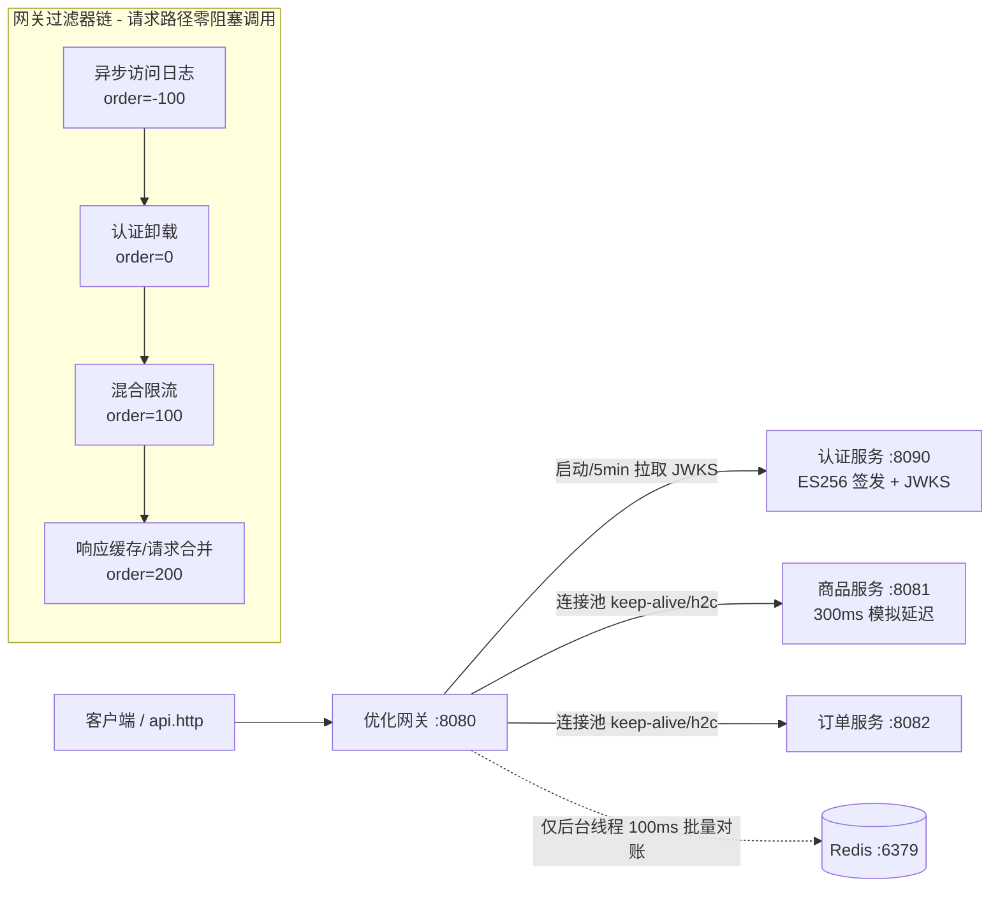

# lin-spring-gateway-optimization

**API 网关成为瓶颈 —— 完整优化架构的可运行实现。**

还原系统设计文章 [API Gateway Becomes a Bottleneck](https://codefarm0.medium.com/api-gateway-becomes-a-bottleneck-system-design-deep-dive-on-gateway-scaling-authentication-cfff15529317)
中的面试场景：流量增长 10 倍后网关 CPU 打满、延迟从 5ms 恶化到 3s、连接池耗尽、平台整体宕机。
本模块把文章给出的全部修复手段落成可运行、可观测、可对照验证的代码。

## 架构



## 文章要点 → 代码映射

| 文章瓶颈/优化 | 实现位置 | 关键效果 |
|---|---|---|
| **认证卸载**：ECDSA 替代 RSA、本地验签 | `auth-service`（ES256 签发 + JWKS）、`gateway/auth/JwtLocalVerifier` | 验签 ~0.05ms，请求路径零认证网络调用 |
| **令牌内省缓存**（LRU） | `gateway/auth/TokenIntrospectionCache`（Caffeine，TTL=min(5min, 令牌剩余寿命)） | 相同令牌跳过验签，纳秒级字典查找 |
| **连接池 + HTTP/2** | `gateway/application.yml`（`spring.cloud.gateway.httpclient.pool/http2`） | 连接复用，目标重用率 >99%，`reactor.netty.connection.provider.*` 可观测 |
| **混合限流**：本地令牌桶 + Redis 100ms 同步 | `gateway/ratelimit/HybridRateLimiter` + `RedisSyncScheduler` | Redis QPS 从每请求 1 次降为每实例 10 次；Redis 宕机自动降级纯本地 |
| **响应缓存（边缘缓存等价物）** | `gateway/cache/ResponseCacheService` + `CacheCoalesceGlobalFilter` | 命中请求不触达下游，300ms → ~1ms（`X-Cache: HIT`） |
| **请求合并（singleflight）** | 同上（in-flight `Sinks.One` 注册表） | 并发相同请求只有 1 个打下游（`X-Cache: COALESCED`） |
| **异步日志**：内存缓冲 + 批量刷出 | `gateway/logging/AsyncAccessLogger`（有界队列 + 后台 worker） | 请求路径零 I/O；队列满丢弃削峰并计数 |
| **监控指标** | 各组件内嵌 Micrometer + `/actuator/prometheus` | 见下表 |

## 模块与端口

| 模块 | 端口 | 角色 |
|---|---|---|
| `auth-service` | 8090 | ES256 令牌签发（TTL 5min）+ JWKS 公钥发布 |
| `gateway` | 8080 | 优化网关（全部横切关注点） |
| `catalog-service` | 8081 | 热点读 API（300ms 模拟延迟 + 请求数计数，验证缓存/合并） |
| `order-service` | 8082 | 常规写/读 API（验证连接池与正常路由） |

## 启动

```bash
# 1. Redis（混合限流的全局计数器）
cd docker && docker compose up -d && cd ..

# 2. 启动四个服务（根目录执行，每个用独立终端）
./mvnw -pl auth-service spring-boot:run
./mvnw -pl catalog-service spring-boot:run
./mvnw -pl order-service spring-boot:run
./mvnw -pl gateway spring-boot:run

# 可选：Prometheus + Grafana 观测栈
cd docker && docker compose --profile observability up -d
```

> 没有 Redis 也能跑：限流自动降级为纯本地模式（可用性优先），
> 其余功能不受影响。

## 演示流程（详见 `api.http`）

1. **认证卸载**：`POST /auth/token` 取令牌 → 无令牌/伪造令牌得 401 →
   首次访问响应头 `X-Auth-Source: LOCAL_VERIFY`，重复访问变 `INTROSPECTION_CACHE`
2. **响应缓存**：访问 `/api/catalog/products` 首次 `X-Cache: MISS`（~300ms），
   10s TTL 内重复访问 `X-Cache: HIT`（~几 ms）；对照 `catalog/stats` 计数不再增长
3. **请求合并**：缓存过期后近乎同时发 N 个相同请求 →
   1 个 `MISS` + N-1 个 `COALESCED`，`catalog/stats` 只 +1
4. **混合限流**：连发 15 个请求 → 前 ~10 个通过（capacity=10），其余 429；
   等待令牌回填（5/s）自动恢复
5. **降级韧性**：`docker stop gateway-optimization-redis` → 网关照常服务，
   `gateway_ratelimit_redis_degraded_total` 增长；重启 Redis 自动恢复对账

## 核心指标（`/actuator/prometheus`）

| 指标 | 含义 / 文章监控要点 |
|---|---|
| `gateway_auth_verify_duration_seconds` | 本地验签延迟 p50/p99（应 < 1ms） |
| `gateway_auth_cache_hit/miss_total` | 令牌内省缓存命中率 |
| `gateway_cache_hit/miss/coalesced_total` | 响应缓存命中 / 合并数 |
| `gateway_upstream_duration_seconds` | 上游调用耗时（缓存未命中路径） |
| `gateway_ratelimit_duration_seconds` | 限流判定延迟（本地，微秒级） |
| `gateway_ratelimit_redis_sync_duration_seconds` | Redis 对账延迟（目标 < 10ms，超标说明间隔过激进） |
| `gateway_ratelimit_rejected_total{reason}` | 429 拒绝（local_bucket / global_limit） |
| `gateway_log_dropped_total` / `gateway_log_queue_size` | 日志削峰丢弃 / 队列水位 |
| `reactor.netty.connection.provider.*` | 连接池 acquired/idle/pending（连接复用观测） |

## 设计取舍（学习提示）

- **过滤器顺序** `日志(-100) → 认证(0) → 限流(100) → 缓存(200)` 与文章的请求阶段分解一致；
  生产环境可按安全策略调整为限流前置（先节流后验签，省 CPU）
- **缓存 key 不含用户维度**：演示的目录数据是公共热点数据；缓存 per-user 数据时
  应把认证后的 `sub` 纳入 key，并处理 `Vary`
- **Redis 对账用 INCRBY + TTL 滚动窗口**：演示足够直观；生产建议 Lua 原子滑动窗口或
  配额租约（quota lease）模式
- **auth-service 每次重启轮换密钥**：网关会按 token 的 `kid` 兜底拉取新 JWKS，
  旧令牌自然失效；生产应保留双 kid 平滑轮换
